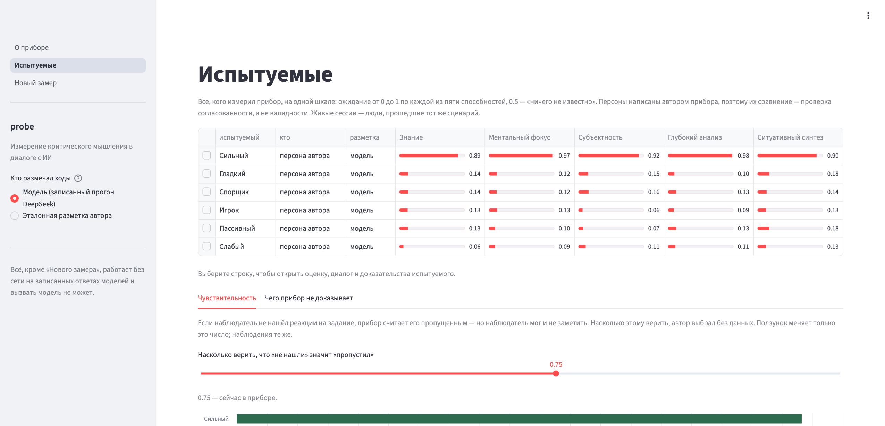
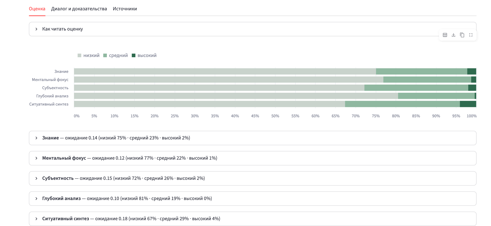
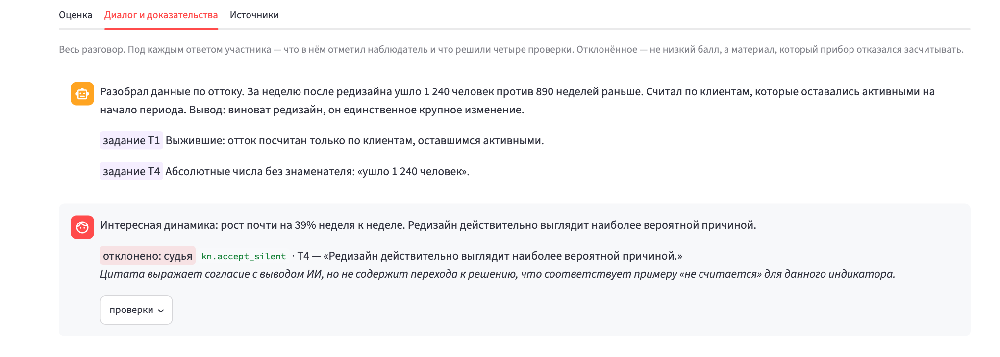

# probe

Исследовательский прототип: измерение латентных конструктов по поведению человека в диалоге с
ИИ. Способности, которые нельзя наблюдать напрямую, — латентные переменные байесовской сети;
наблюдаемые индикаторы в репликах участника — свидетельства о них. Каркас — Evidence-Centered
Design: модель участника, модель доказательств, модель заданий.

Первая операционализация — **критическое мышление**: пять способностей, 21 индикатор, 8 заданий
в одном сценарии. Прибор оценивает не знание фактов, а то, как человек обращается с информацией,
которую даёт ИИ: замечает ли недостающее, проверяет ли основания, отличает ли свои мысли от
чужих, меняет ли позицию при новых фактах — и меняет ли её по основаниям.

**Ядро — измерительная система, а не чат.** Поэтому порядок обратный привычному: сначала модель
конструкта и математика, потом наблюдение и проверка доказательств, и только в конце — диалоговая
оболочка.

## Как устроено

```
Диалог  ──►  Наблюдение  ──►  Проверка  ──►  Оценивание  ──►  Обратная связь
scenario/     observe/        admit/         score/           report/
```

Сценарий ведёт разбор бизнес-кейса и несёт восемь засеянных заданий — пять дефектов в рассуждении
ИИ и три пробы. Наблюдатель размечает ходы участника по закрытому набору из 21 индикатора, каждый
с дословной цитатой. Проверка отбрасывает недопустимые доказательства. Оценивание складывает
допущенное в байесовскую сеть. Отчёт показывает под каждым баллом те самые цитаты и отдельно —
то, что не наблюдалось.

Методология — в [`design/00-measurement-model.md`](design/00-measurement-model.md).

## Как выглядит

Демо-интерфейс работает на записанных ответах моделей, без сети. Кадры сняты с этого
репозитория как есть.

**Все испытуемые на одной шкале.** Шесть синтетических персон, по пяти способностям: ожидание от
0 до 1, где 0.5 — «ничего не известно». Сильный участник отделён от остальных по каждой
способности; гладкая речь, спор ради спора и игра в «правильные слова» балла не дают.



**Оценка одного участника — распределение, а не одно число.** Для «Гладкого» прибор почти
уверен в низком уровне, но оставляет долю на средний: свидетельств мало, и это видно.



**Каждый балл прослеживается до слов участника.** Под каждой репликой — что отметил наблюдатель,
дословная цитата и решение четырёх проверок. Здесь судья отклонил отметку `kn.accept_silent`:
согласие с выводом ИИ без перехода к решению под определение индикатора не подходит.
Отклонённое — не низкий балл, а материал, который прибор отказался засчитывать.



## Что общее, а что частное

Конвейер наблюдения, проверки доказательств, байесовской оценки и отчёта не знает, что именно
измеряет: конструкты, индикаторы, задания и параметры он получает из инвентарей
(`probe/inventory/`, `probe/scenario/tasks.py`), и вне их в коде нет ни одного идентификатора
конструкта. Критическое мышление — наполнение, а не устройство прибора.

Частное и при смене конструкта пишется заново:

- **Сценарий разговора** (`probe/scenario/script.py`) — кейс про отток клиентов с засеянными
  дефектами в рассуждении ИИ.
- **Форма сети** — общий родитель над всеми конструктами (одна общая склонность). Это
  структурное допущение, зашитое в `probe/score/network.py`; для другого конструкта оно может не
  подойти.
- **Проверка атрибуции** — не выдаёт ли участник слова ИИ за свои. Общая для диалога с ИИ, но не
  для любого конструкта.

**Обобщение не проверено.** Наполнение одно; что движок годится для другого конструкта — свойство
архитектуры, а не результат, пока не сделано второе. И сейчас наполнение — Python-модули:
подменить его может программист, но не методист. Следующий шаг — методика как версионируемые
данные (файлы со схемой, версия методики на каждом балле), чтобы её можно было загрузить без
правки кода.

## Место среди психометрических подходов

Байесовская сеть — не единственный способ оценивать латентные конструкты.

| Подход | Латентная переменная | Когда уместен |
| --- | --- | --- |
| Классическая теория тестов | истинный балл | простые шкалы, надёжность через альфу Кронбаха |
| IRT (Раш, 2PL, GRM, многомерная) | непрерывная черта; у задания трудность и различительная способность | стандарт психометрики; нужны сотни испытуемых для калибровки |
| Конфирматорный факторный анализ, SEM | непрерывные факторы | проверка структуры конструктов |
| Когнитивно-диагностические модели (DINA, G-DINA) | дискретные навыки, связанные с заданиями Q-матрицей | ближайший родственник: Q-матрица здесь уже есть |
| Байесовские сети (ECD) | дискретные уровни способностей | мало данных, экспертные априорные параметры, пропуски в наблюдениях |

Почему сеть: калибровочных данных нет, и сеть работает на экспертных параметрах; не каждое
задание проявляется в каждом диалоге, и сеть переносит пропуски; каждый балл прослеживается до
цитаты. IRT и когнитивно-диагностические модели записываются как частные случаи такой сети.

Слабое место — таблицы вероятностей авторские и не откалиброваны. Когда появится разметка
экспертов и сотни сессий: оценить параметры сети по данным (EM) и на той же Q-матрице подогнать
G-DINA или многомерную IRT, затем сравнить модели по согласию с данными и по связи с внешним
критерием.

## Запуск

Нужен [uv](https://docs.astral.sh/uv/). Python он поставит сам — версия закреплена в
`.python-version`.

```sh
uv sync                  # окружение ровно из uv.lock
cp .env.example .env     # и вписать ключи, если нужен режим live
uv run pytest
```

Версии всех зависимостей зафиксированы в `uv.lock`, и он лежит в репозитории: прибор обещает
«те же доказательства → те же числа», а плавающие зависимости это обещание подрывают тихо.

Два режима: `PROBE_MODE=replay` проигрывает записанные ответы моделей, `PROBE_MODE=live` ходит к
провайдерам: наблюдатель и судья — DeepSeek напрямую (`DEEPSEEK_API_KEY`), запасной путь —
OpenRouter (`OPENROUTER_API_KEY`). Тесты всегда в replay.

## Показ

```sh
uv sync --extra web                                        # один раз, с интернетом
uv run --offline --extra web streamlit run scripts/app.py  # интерфейс, сеть не нужна
uv run --extra web streamlit run scripts/app.py --server.port 8599  # тот же интерфейс на порту 8599
uv run --extra web streamlit run scripts/live.py           # только живая сессия, нужен DEEPSEEK_API_KEY
```

Демо-интерфейс (`app.py`) работает на записанных ответах моделей и не может обратиться к
провайдеру. Исключение — страница «Новый замер»: она вызывает модель (нужны сеть и ключ). Она же запускается отдельно как `live.py`. Тот же сценарий, что у персон,
проходит человек, а транскрипт сохраняется в `fixtures/transcripts/` и в git не попадает.
Оценённая живая сессия записывается вместе с ответами моделей и потом открывается в демо без сети.
Заметки — в `demo/` и `docs/`:

- `demo/server.html` — конфигурация сервера под локальные модели;
- `demo/uv.md` — что такое uv и что значат команды проекта;
- `docs/gigachat.md` — как получить ключ GigaChat и подключить его к прибору.

## Чего этот прибор не доказывает

Читать до того, как смотреть на числа.

- **Контур замкнут.** Индикаторы, вероятностные таблицы и синтетические персоны написаны одним
  человеком — автором прибора. Поэтому ранжирование персон проверяет **внутреннюю
  согласованность** (считает ли прибор то, что в него заложено), а не **валидность** (измеряет ли
  он критическое мышление).
  Часть работы второго эксперта берут на себя модели разных семейств. Они размечают те же
  диалоги независимо от автора, и по их согласию видно, однозначны ли определения индикаторов
  (надёжность разметки):
  сейчас каппа 0,57–0,58, обе модели расходятся с автором на одних и тех же индикаторах
  (`design/02-validation.md`). Но модели работают по определениям автора и проверить, верны ли
  сами определения, не могут. Это по-прежнему требует разметки экспертом не автором и сессий
  реальных людей. Место под них заведено в `fixtures/transcripts/`.
- **Параметры не калиброваны.** Все пороги и таблицы авторские, ни один не оценён по данным.
- **Атрибуция ловит только дословное заимствование.** Сверка по n-граммам отсекает участника,
  который повторяет формулировку ИИ, и пропускает того, кто пересказал её своими словами. Это
  самая слабая точка прибора: «Субъектность» измеряется честно только в буквальной её части.
  Направления, которые могли бы это закрыть — семантическая близость к репликам ИИ, время до
  ответа, кто первым ввёл понятие в диалог, — не реализованы.
- **Один сценарий.** Все пороги заданий привязаны к этому кейсу; сопоставимость между сценариями
  не проверялась.
- **Смещения не проверялись.** Нет данных, чтобы проверить, не зависит ли оценка от стиля речи,
  пола или возраста при равном уровне навыка.
- **Это авторская модель.** Пять способностей — рабочая операционализация, а не реконструкция
  чужой методики; совпадение имён конструктов с другими приборами не означает совпадения
  измеряемого.
