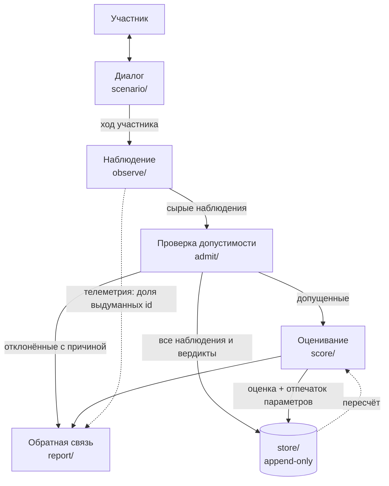

# Архитектура

Пять стадий, каждая — узкий компонент с одной функцией. Разделение не ради красоты схемы: оно
нужно, чтобы можно было сказать, какой именно шаг ошибся, когда оценка окажется неверной.

Стадии не знают, какой конструкт измеряют: конструкты, индикаторы, задания и параметры приходят
из инвентарей (`probe/inventory/`, `probe/scenario/tasks.py`), вне которых в коде нет ни одного их
идентификатора. Привязаны к конкретному конструкту три вещи: сценарий (`probe/scenario/script.py`),
форма сети — общий родитель над конструктами (`probe/score/network.py`) — и проверка атрибуции,
общая для диалога с ИИ. Что конвейер переносится на другой конструкт, не проверено: наполнение
одно.



| Стадия | Модуль | Делает | Не делает |
| --- | --- | --- | --- |
| Диалог | `scenario/` | Ведёт кейс, предъявляет задания | Не оценивает и не видит оценок |
| Наблюдение | `observe/` | Размечает один ход по закрытому инвентарю | Не решает, засчитывать ли |
| Проверка | `admit/` | Четыре фильтра допустимости | Не меняет силу наблюдения |
| Оценивание | `score/` | Агрегация и байесовский вывод | Не вызывает моделей вообще |
| Обратная связь | `report/` | Постериоры, цитаты, пробелы, отклонённое | Не пересчитывает ничего |

## Что где лежит

```
probe/config.py        единственный модуль, читающий окружение
probe/models.py        роли моделей; наблюдатель и судья — разные семейства
probe/llm.py           один клиент; режимы live и replay, кассеты
probe/transcript.py    сессия как данные: ходы + какие задания предъявлены
probe/run.py           сквозной прогон: транскрипт → сессия в базе → отчёт
probe/scenario/script.py      сценарий churn-v1 как автомат: шаги, лист фактов, фильтр утечек
probe/scenario/interlocutor.py  собеседник: короткая реакция между шагами, ничего не оценивает
scripts/app.py         демо: страницы в app_pages/, данные общие в app_data.py; все
                       страницы, кроме «Нового замера» (app_pages/live.py), — только replay
scripts/live.py        та же страница «Новый замер» отдельным окном; нужен ключ провайдера
```

## Решения, которые стоит защищать отдельно

### Живая сессия — отдельная страница, а не режим демо

Страницы демо, показывающие оценки, не могут обратиться к провайдеру: конфигурация собирается
через `replay_only()`, `.env` они не читают. Живая сессия существует ровно для того, чтобы
обращаться, поэтому граница проходит по странице: «Новый замер» (`scripts/app_pages/live.py`) —
единственная, которая читает ключ и вызывает модель. Это не переключатель режима на других
страницах: из списка испытуемых или отчёта сетевого пути нет.

Решение изменено 2026-10-16. Раньше живая сессия была отдельным приложением, чтобы демо целиком
обещало отсутствие сети. Но демо показывается автором на звонке, никому не отдаётся, и
переключаться между двумя окнами в видеоконференции неудобно. `scripts/live.py` остался как
та же страница в отдельном окне.

Сценарий, по которому идёт живая сессия, — тот же, что у персон (`design/00` §3, живой режим).
Тест прогоняет ответы персоны через автомат живой сессии и требует попадания в записанные кассеты
наблюдателя: ключ кассеты покрывает весь промпт, так что попадание доказывает, что живой путь
спрашивает наблюдателя ровно о том же, о чём путь персон. Транскрипт сохраняется в формате персон
в `fixtures/transcripts/`, который git не видит: это слова человека.

При оценке живая сессия всегда записывает ответы наблюдателя и судьи в кассеты, в свою папку
`fixtures/transcripts/cassettes/`, отдельно от кассет персон. Поэтому оценённая живая сессия
открывается в офлайн-демо рядом с персонами и показывает ту же оценку, что была получена при
разборе, а не новую: разметка провайдера недетерминирована, и повторный живой прогон дал бы
другие числа.

### Наблюдатель и судья — разные семейства моделей

Судья одного семейства с наблюдателем разделяет его слепые зоны. Их согласие тогда говорит о паре
моделей, а не об участнике, и перестаёт быть метрикой. Судья к тому же работает **на опровержение**:
его просят сбить разметку, а не подтвердить её, и при сомнении — опровергать. Судья, которому
задают вопрос «верно ли?», соглашается почти со всем правдоподобным.

**В демо-версии это правило нарушено осознанно.** Под рукой был только ключ DeepSeek, поэтому
судья — `deepseek-v4-pro`: другая и более сильная модель, но то же семейство. Он отсекает часть
ошибок разметки, но его согласие с наблюдателем не является независимой проверкой, и отчёт пишет
об этом в шапке. Возврат к Gemini через OpenRouter — одна строка в `probe/models.py`.

Расхождение наблюдателя и судьи — не дефект, который надо настроить до нуля. Это число, которое
показывают в разделе валидации.

### Идентификаторы в схеме — строки, а не перечисления

Перечисление из 21 значения в каждом запросе стоит токенов на каждом вызове и, главное, делает
выдуманный id **невыразимым**, а значит неподсчитываемым. Доля выдуманных id — метрика здоровья
прибора, поэтому id обязан иметь возможность быть неверным и проверяться постфактум.

### Инвентарь целиком — в каждом промпте, который размечает

Наблюдатель без инвентаря не отказывается работать. Он выдаёт правдоподобные названия, все они
гибнут на валидации, и богатый на поведение ход записывает ноль наблюдений. Отказ был бы безопаснее
этого, потому что отказ видно.

### Проверка допустимости — три механических фильтра и один модельный

| Фильтр | Чем является | Что ловит |
| --- | --- | --- |
| `grounding` | Подстрока после нормализации | Цитату, которой нет в сообщении |
| `attribution` | Покрытие n-граммами реплик ИИ; только для положительных индикаторов | Дословный возврат слов ИИ как своих |
| `meta_turn` | Узкие регулярные выражения | Вопросы об оценке и сообщения о сбоях |
| `adjudication` | Модель другого семейства (в демо — того же, см. ниже) | Правдоподобную, но неверную разметку |

Три из четырёх не требуют модели. Это сознательно: обещание «оценка связана с конкретными
действиями» должно держаться на коде, а не на том, насколько хорошо попросили модель.

Вердикт каждого фильтра хранится отдельно, а не схлопывается в булево: отчёт обязан уметь сказать,
**почему** доказательство исключено. «Мы отбросили это как заимствованное» — другое утверждение для
участника, чем низкий балл, и смешивать их значит превращать прибор в непрозрачный.

Порядок — от дешёвого к дорогому; судья последний, потому что стоит вызова. Если заземление не
прошло, атрибуция не запускается и **не записывает «пройдено»**: сравнивать было нечего, а бодрое
«пройдено» читалось бы как «мы проверили».

### Две ступени защиты независимости плюс третья

Описаны в [00-measurement-model.md](./00-measurement-model.md) §5. Коротко: одно наблюдение на
индикатор на ход, один узел на индикатор на сессию, и одно наблюдение кормит ровно один узел.

### Режим replay — не удобство для тестов

Кассета ключуется всем, что может изменить ответ: модель, версия промпта, точные сообщения, схема.
Попадание в кассету доказывает, что запрос был тот же; промах — громкая ошибка, а не тихий поход в
сеть. Тесты всегда в replay: тест, доходящий до провайдера, не тест.

## Две заглушки, о которых отчёт говорит вслух

**Эталонная разметка вместо наблюдателя.** `--observer gold` подставляет написанные руками метки
персоны. Это проверяет арифметику прибора и **не проверяет наблюдателя**. Заглушка живёт внутри
продукта, а не в тестах, именно затем, чтобы отчёт мог в этом признаться — он и признаётся, строкой
в шапке.

**Отключённый судья.** `--no-adjudicator` экономит вызовы; отчёт пишет, что проверка допустимости
неполна.

## Найденное при сборке

**Ложное срабатывание атрибуции на коротких цитатах.** Персона `gaming` отвечает на пробу-меню
«Базу сравнения.» — это правильный ответ, и он неизбежно повторяет слова самого варианта. Засчитать
такое как заимствование значило бы штрафовать всякого немногословного участника: систематическое
смещение, замаскированное под проверку честности. Цитаты короче пяти слов объявлены непроверяемыми,
и фильтр записывает, что он **не был применён**, а не что всё в порядке.

**Атрибуция не наказывает за игру — она просто не засчитывает.** Участник, вернувший слова ИИ как
свои, оказывается там же, где участник, не сказавший ничего. Штраф пришлось бы обосновывать
отдельно, а «мы не знаем, его ли это мысль» — честно ровно до «не засчитано».

**Атрибуция применяется только к положительным индикаторам.** Найдено на живом прогоне
(2026-10-11). Фильтр защищает принцип «вклад ИИ не приписывается человеку», то есть не даёт
засчитать участнику **заслугу** за чужие слова. Отрицательный индикатор заслуги не приписывает.
Хуже того, для `ag.parrot` — «воспроизводит формулировку ИИ как собственную» — совпадение со
словами ИИ и есть проявление: фильтр, применённый к нему, делал индикатор недопустимым по
построению. Эталонная разметка этого не показала, потому что автор размечал ходы `gaming` как
положительные индикаторы, которые надо срезать; модель прочитала те же ходы точнее — как повтор.
Для отрицательных индикаторов фильтр записывает, что **не применялся**, и почему.

Следствие для предыдущего пункта: если наблюдатель размечает игру как `ag.parrot`, она
снижает «Субъектность». Это не штраф за игру, придуманный сверх модели, а работа индикатора,
который в инвентаре был с самого начала.
